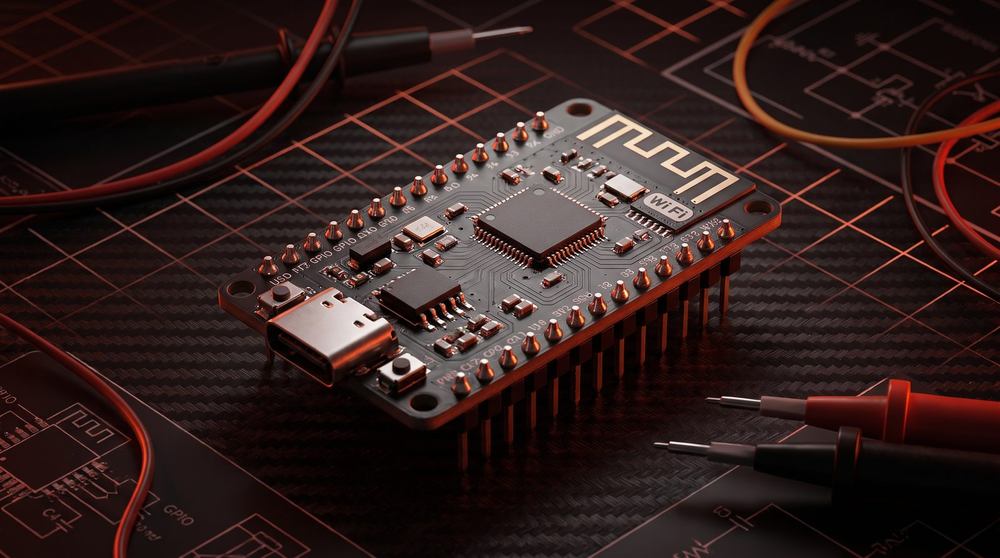

<p align="center">
  
</p>

<p align="center">
  <a href="https://github.com/zhameersheraz/esp32sec/blob/main/LICENSE"></a>
  <a href="https://github.com/zhameersheraz/esp32sec/stargazers"></a>
  <a href="https://github.com/zhameersheraz/esp32sec/issues"></a>
  
  
</p>

<h1 align="center">esp32<span style="color:#ff4d2e">.</span>sec</h1>

<p align="center">
  <strong>ESP32 / ESP8266 firmware analysis and security toolkit.</strong><br>
  Flash dump, UART sniff, partition parse, secure boot check — five focused Python tools, one command-line flow.
</p>

<p align="center">
  <a href="https://zhameersheraz.github.io/esp32sec/"><strong>Live site &rarr;</strong></a> &nbsp;&middot;&nbsp;
  <a href="#quick-start"><strong>Quick start</strong></a> &nbsp;&middot;&nbsp;
  <a href="#tools"><strong>Tools</strong></a> &nbsp;&middot;&nbsp;
  <a href="#hardware"><strong>Hardware</strong></a>
</p>

---

## What this is

`esp32sec` is a small, focused Python toolkit for poking at ESP32 / ESP8266
devices during authorized security research. No custom dev board, no cloud
service, no telemetry. Just five scripts you can read in 5 minutes each.

```
+----------+       +-----------+       +-----------------+
|  Target  | <---> | UART bus  | <---> | Your laptop     |
|  ESP32   |  UART | CP2102    |  USB  | (Linux/mac/WSL) |
+----------+       +-----------+       +-----------------+
                                            |
                          +-----------------+-----------------+
                          |                 |                 |
                          v                 v                 v
                   flash_dump.py    uart_sniffer.py   firmware_inspect.py
                   (4MB in 30s)     (boot + runtime)   (strings, magic, NVS)
                                            |
                                            v
                                   partition_table.py
                                   secure_boot_check.py
```

## Tools

| #  | Script                     | What it does                                                |
| -- | -------------------------- | ----------------------------------------------------------- |
| 01 | `tools/flash_dump.py`      | Dump the full SPI flash over UART using `esptool`           |
| 02 | `tools/uart_sniffer.py`    | Capture raw boot-ROM and runtime UART output                 |
| 03 | `tools/firmware_inspect.py`| Quick-look at a flash image: magic, NVS, strings            |
| 04 | `tools/partition_table.py` | Parse the OTA / NVS / spiffs partition table from a dump    |
| 05 | `tools/secure_boot_check.py` | Heuristic check for secure boot / flash crypto state      |

## Quick start

```bash
# 1. Clone and install dependencies
git clone https://github.com/zhameersheraz/esp32sec.git
cd esp32sec
pip install -r requirements.txt

# 2. Wire up: ESP32 <-> CP2102/FTDI <-> USB

# 3. Dump the flash
sudo python3 tools/flash_dump.py --port /dev/ttyUSB0 --output flash.bin

# 4. Inspect it
python3 tools/firmware_inspect.py flash.bin --strings
python3 tools/partition_table.py flash.bin
python3 tools/secure_boot_check.py flash.bin

# 5. Sniff live UART during boot
sudo python3 tools/uart_sniffer.py --port /dev/ttyUSB0 --baud 74880
```

## Hardware

You probably already have it.

**Required**
- ESP32 or ESP8266 dev board
- USB-to-UART bridge: CP2102, FTDI FT232, or CH340
- Linux, macOS, or WSL on the host
- Python 3.10 or newer

**Recommended**
- USB logic analyzer (Saleae, sigrok-compatible clones)
- Multimeter for verifying 3.3 V levels
- ESP-PROG (or compatible JTAG) for deeper debugging
- Soldering iron for off-dev-kit targets

## Project layout

```
esp32sec/
├── assets/                 # 3D-rendered hero / workflow images
├── docs/
│   └── index.html          # GitHub Pages site
├── tools/
│   ├── flash_dump.py
│   ├── uart_sniffer.py
│   ├── firmware_inspect.py
│   ├── partition_table.py
│   ├── secure_boot_check.py
│   └── __init__.py
├── LICENSE                 # MIT
├── README.md               # this file
└── requirements.txt
```

## Legal

Only test against devices you **own** or have **explicit written permission**
to test. The author is not responsible for misuse.

This toolkit is for:
- Personal hardware you own
- Authorized penetration tests (with signed scope)
- CTF competitions and educational labs
- Academic security research

Not for: unauthorized access, planted devices, anything shady.

## License

MIT &mdash; see [LICENSE](LICENSE).
